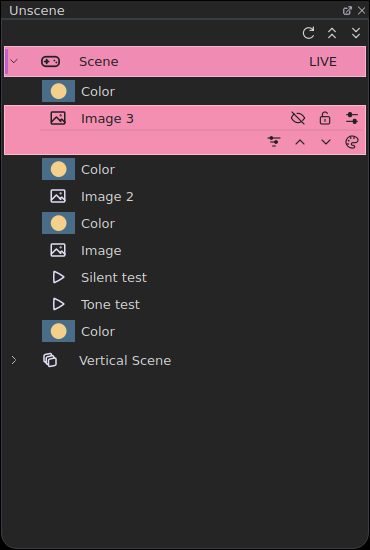
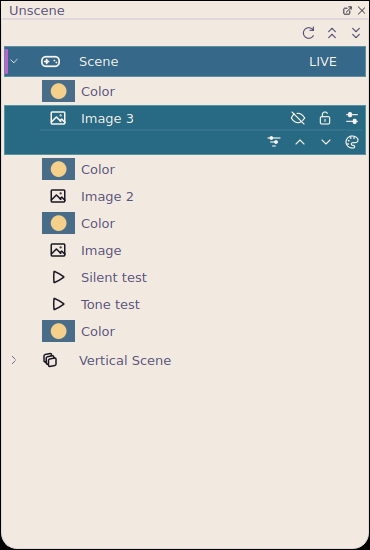
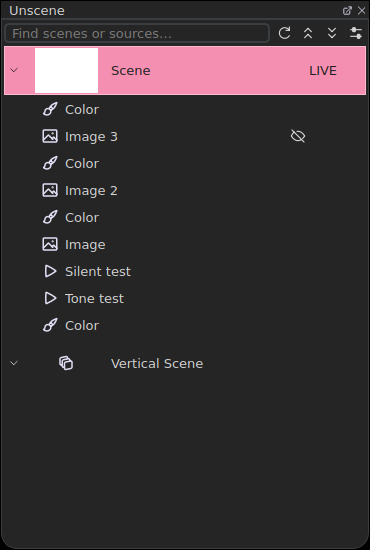
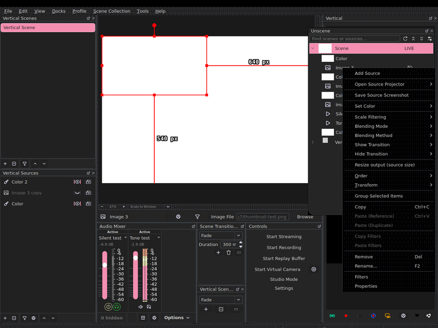
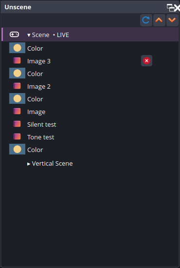

# Unscene

**Scenes and sources, unfolded.**

A standalone, native Qt dock for OBS that combines Scenes and Sources. Scene rows expand independently; the hover arrow activates a scene (selects preview in Studio Mode). Source rows expose visibility, lock and properties on hover, with a second row for filters, ordering and audio mute where applicable. Groups can expand. It uses the OBS theme's palette and standard icons.

Snapshots are cached by source UUID, captured only for visible rows whose source is already showing, with at most one attempt per 400 ms timer cycle. No forced source activation; unavailable snapshots retain icons. Refresh snapshots manually via the toolbar. Snapshots are currently session-only and do not automatically track changes to content.

## Theme integration
Unscene inherits the active OBS theme palette and native list selection/hover rendering. Default source artwork uses the OBS main window's theme icon properties when available, with semantic palette-colored fallbacks. Action glyphs, disclosure arrows, labels, and selected text follow the palette; custom row colors remain optional. File and color dialogs use in-process Qt styling. Theme change events invalidate the row presentation without changing source state.





## Navigation and density
Search the scene collection by name, including sources inside collapsed scenes and groups. Matching branches retain their hierarchy; clearing search restores the previous expansion state. Expand/collapse settings persist per collection name using scene and item identities. The toolbar density menu independently sets scene and source artwork to Compact, Standard, or Large. Compact disables automatic snapshot capture for those rows while retaining custom artwork.




## Source management
Hover a scene and click the plus button (or right-click it) to open the searchable source picker. Existing sources are added as shared references; New source lists available input types and prompts for a unique name. New configurable sources open their native properties.

Use a source’s More actions (ellipsis) for properties, filters, transform editing, copy, rename, appearance, and removal. Copy a source through Unscene’s More actions, then use the destination scene’s More actions to choose Paste (reference) or Paste (duplicate). Pasting preserves the copied item's transform, crop, scale filter, blending, visibility, and lock state. A duplicate creates an independent source when the source type permits it. Unscene keeps a collection-scoped clipboard and also invokes native OBS copy; native-to-Unscene clipboard import is not supported. Adding or pasting into an inactive scene does not switch the live scene. Removal targets only the selected scene item, with confirmation.


## Native OBS context menus
Right-click a scene or source in the current editing scene to open OBS’s actual context menu, including native submenus, plugin integrations and native action behavior. Unscene validates the selected scene and source item against OBS’s current model, including source instances sharing a name. The original Scenes and Sources docks may be hidden.

For inactive scenes, or if the native selection cannot be safely resolved, right-click instead opens Unscene’s safe context menu. An explicit Activate scene and open OBS menu action (Select preview scene in Studio Mode) is offered for inactive scenes. Right-click never silently changes the program scene. The ellipsis always opens Unscene’s own actions, independently of native selection. Native rename may require the native dock to be visible; use Unscene’s Rename action if needed. Native clipboard copying remains separate from Unscene’s cross-scene clipboard.



## Custom appearance
Open a scene or source’s More actions menu and choose Appearance. Choose automatic artwork, one of 13 built-in line icons, or import a local image/icon file. Choose a row color independently; Clear restores the theme color and Reset restores both defaults. Confirm with OK.

Appearance follows the OBS source UUID, so a reused source has consistent artwork and color across scenes. Imported artwork is stored as a bounded PNG in Unscene's own configuration, not as an external file dependency. Custom artwork takes precedence over automatic snapshots. These settings do not change the stream or the native OBS source configuration.



## Build (Linux / Qt 6 / OBS 32.2 tested)
```sh
cmake -S . -B build -Dlibobs_DIR=/usr/local/lib/cmake/libobs -Dobs-frontend-api_DIR=/usr/local/lib/cmake/obs-frontend-api
cmake --build build
ctest --test-dir build --output-on-failure
cmake --install build --prefix "$HOME/.config/obs-studio/plugins/unscene"
```
Restart OBS and enable the Unscene dock from Docks. Existing docks are unaffected.

First prototype screenshot (before the rename):


## Current limitations

Not yet a full native dock replacement. Drag/drop, nested scene traversal, scene/group creation and deletion, general snapshot invalidation, and CI are still pending. Direct add/paste/remove/rename actions do not yet integrate with OBS Undo. The add picker and paste target root scenes; copying groups or nested scenes is not supported. Expansion preferences are keyed by collection name; renaming a collection does not currently migrate them. Group traversal and Studio Mode activation are implemented but have not been runtime-validated. GPU readback is synchronous and not yet profiled. Inactive sources without cached snapshots remain placeholders.
