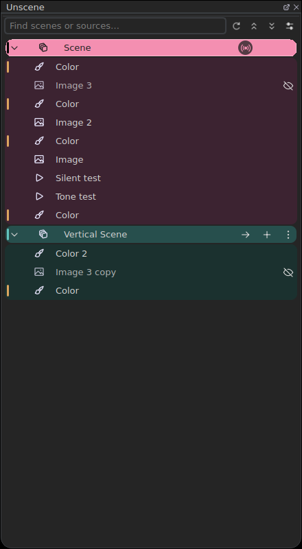
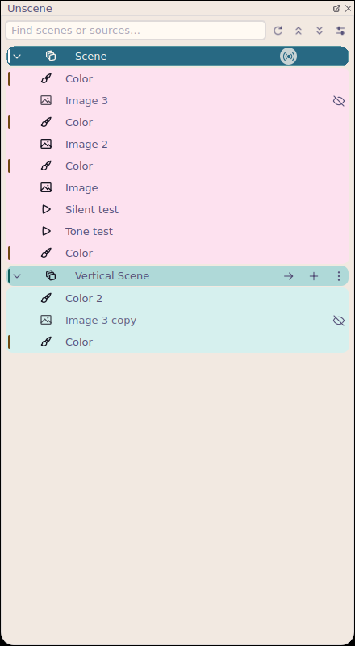
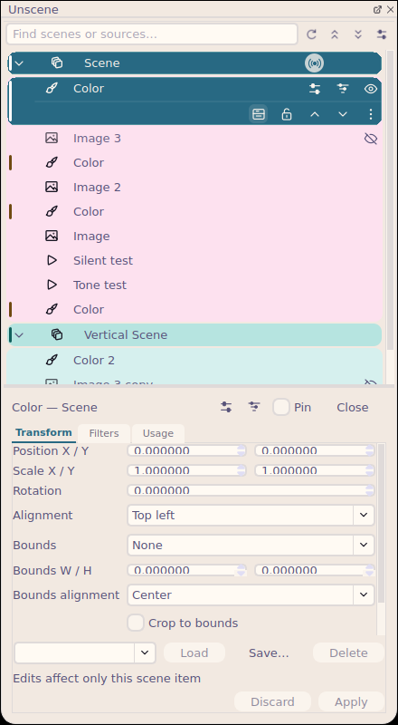

# Unscene

**Scenes and sources, unfolded.**

A native OBS Studio dock that brings your entire scene collection into one
expandable, theme-aware workspace. Organize and edit sources without constantly
switching scenes. No Aftermarket dependency.

> **0.1.0 public-preview candidate.** Developed and runtime-tested on Linux x86_64
> with OBS Studio 32.2.0 and Qt 6. Other OBS versions, Windows, macOS and Flatpak
> packaging are not qualified yet.

| Dark theme | Light theme |
| :---: | :---: |
|  |  |

## Features

- **Scenes and sources in one dock:** expand independently of activation; search
  collapsed scenes and groups; persistent expansion and thumbnail density.
- **Dynamic appearance:** Material-inspired tonal scene containers, custom colors,
  artwork and icons, dimmed hidden sources, and theme-aware live/hover controls.
- **Source management:** add existing or new inputs, copy references or duplicates
  across scenes, rename, reorder with animated drag and edge scrolling, and
  access properties, filters and native context menus.
- **Inspector:** editable transform drafts with presets, shared filter-stack
  management and direct source usage counts; pin the current item or follow selection.
- **Portable transfers:** copy/import/export individual sources and filters or
  filter stacks as JSON. Existing sources are not overwritten.
- **Motion and safety:** Off/Fast/Smooth motion settings, native OBS undo for
  supported edits, and no snapshot capture by default.



[Detailed usage and limitations](docs/usage.md) · [Build checks](https://github.com/myrqyry/unscene/actions)

## Build and install

Requires a C++17 compiler, CMake 3.21+, Qt 6 Widgets/Test/Svg development
packages, and libobs plus obs-frontend-api development packages matching the
target OBS version. The verified target is OBS 32.2.0.

```sh
cmake -S . -B build -DCMAKE_BUILD_TYPE=Release
cmake --build build --parallel 2
ctest --test-dir build --output-on-failure
cmake --install build --prefix "$HOME/.config/obs-studio/plugins/unscene"
```

If CMake cannot locate the OBS SDK, pass
`-Dlibobs_DIR=/path/to/sdk/lib/cmake/libobs` and
`-Dobs-frontend-api_DIR=/path/to/sdk/lib/cmake/obs-frontend-api`.
Restart OBS and enable **Docks → Unscene**. You can leave the original docks open
or hide them yourself. To uninstall, close OBS and remove only the installed
Unscene plugin directory; appearance/navigation settings are separate.

CI builds the pinned Linux OBS 32.2.0 SDK, runs the regression suite and checks
the test archive and source archive. CI artifacts are preview/test packages,
not automatically published releases. For a verified Linux test archive,
extract its `bin/64bit/unscene.so` into the Unscene plugin directory above
alongside the included LICENSE.

## Important limitations

- Some direct management actions (add, reference/duplicate paste, remove,
  rename) do not have native undo. Native menus may fall back to Unscene's own
  menus if OBS's internal model cannot be matched safely.
- Portable JSON does not package external files or remap third-party source
  references. Import only trusted settings. Scene/group bundles and item
  show/hide transitions are not supported.
- Optional idle snapshot capture uses synchronous graphics readback; disabled
  by default and gated while outputs are active. No streaming benchmark yet.
- Cross-parent drag, full scene/group management and indirect nested scene
  usage traversal are not implemented. This is not yet a complete native-dock
  replacement.

## License

GPL-2.0-or-later. See [LICENSE](LICENSE) and [attribution](NOTICE.md).
