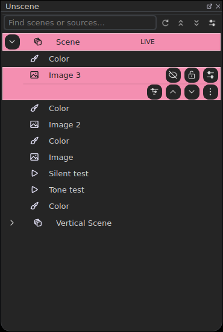
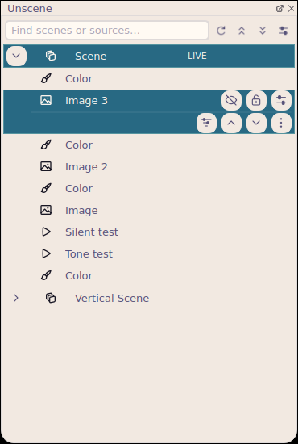
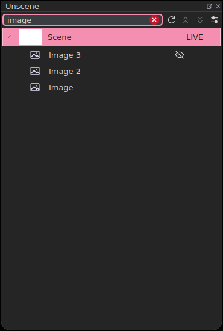
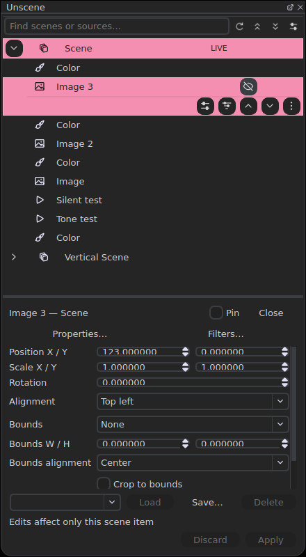
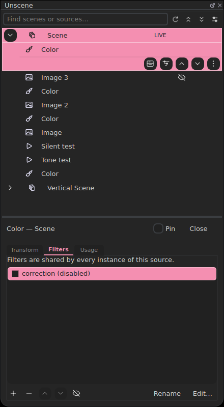
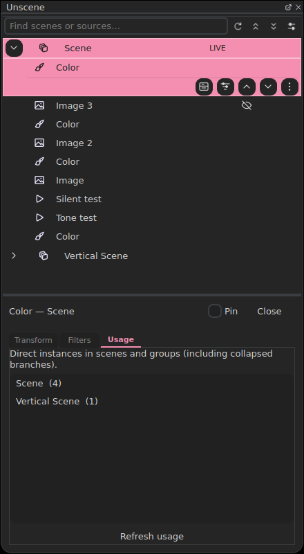
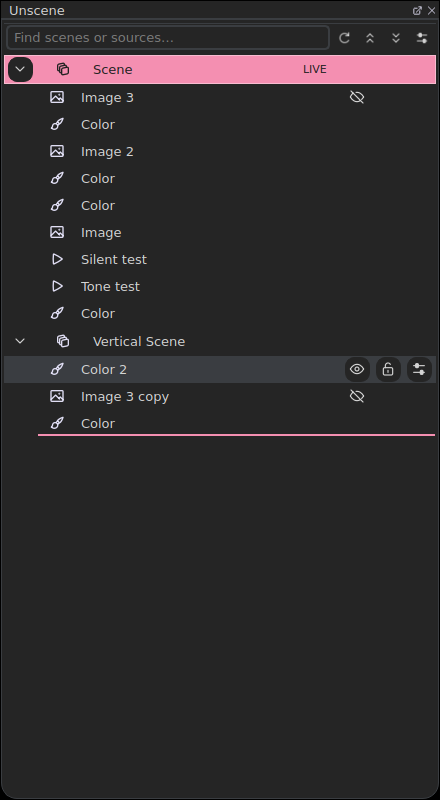
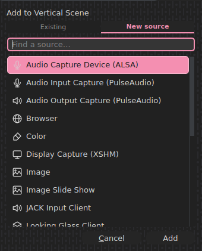
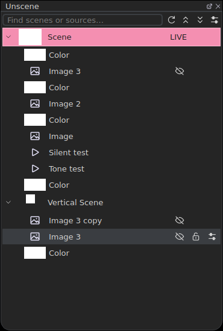
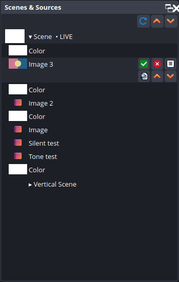

# Unscene

**Scenes and sources, unfolded.**

A standalone, native Qt dock for OBS that combines Scenes and Sources. Scene rows expand independently; the hover arrow activates a scene (selects preview in Studio Mode). The active program scene replaces that arrow with a persistent circular live icon instead of a text label; in Studio Mode the live icon can still select the program scene for preview when needed. Source rows expose visibility, lock and properties on hover, with a second row for filters, ordering and audio mute where applicable. Groups can expand. It uses the OBS theme's palette and standard icons.

Snapshots are cached by source UUID, captured only for visible rows whose source is already showing, with at most one attempt per 400 ms timer cycle. No forced source activation; unavailable snapshots retain icons. Refresh snapshots manually via the toolbar. Snapshots are currently session-only and do not automatically track changes to content.

## Theme integration
Unscene delegates ordinary button surfaces, icon placement, borders, hover and press states to the active Qt/OBS style. Scene headers, branch containers and selected/hovered rows use metric-derived rounded geometry; disclosure, scene activation and add-source controls use circular silhouettes while retaining native button painting. Button dimensions use native style content sizing and icon metrics; row padding and minimum height derive from native list-item styling. Layout spacing uses Qt metrics and the toolbar is a native QToolBar. Source artwork uses native OBS theme icon properties when available. Row foreground and button foreground are resolved separately to keep selected rows readable. Theme changes rebuild the presentation without changing source state. Thumbnail density, semantic action glyphs, custom row accents, hierarchy indentation and animation timing remain Unscene design choices; not every private OBS theme token is exposed through Qt.





## Navigation and density
Search the scene collection by name, including sources inside collapsed scenes and groups. Matching branches retain their hierarchy; clearing search restores the previous expansion state. Expand/collapse settings persist per collection name using scene and item identities. The toolbar density menu independently sets scene and source artwork to Compact, Standard, or Large. Compact disables automatic snapshot capture for those rows while retaining custom artwork.




## Graphics isolation
Dock settings → Snapshot capture defaults to Cached artwork only (no GPU capture). Existing session snapshots and custom artwork remain visible; on a fresh session, uncached rows use icons. Opt in to Generate snapshots when outputs are idle to populate thumbnails. Capture is blocked while OBS reports streaming, recording, replay buffer or virtual camera active. Refresh does not discard cached snapshots while capture is blocked. Snapshot capture in the optional idle mode still uses synchronous graphics-context access; it is not a zero-contention path. Animation uses only GUI-side widget transitions.

## Motion
Unscene uses short, interruptible Qt transitions for scene/group expansion, source secondary controls, search results, hover buttons, disclosure chevrons and snapshot refresh feedback. Unchanged rows are retained instead of recreated. Dock settings → Animations offers Off, Fast (90 ms) and Smooth (150 ms, default), persisted independently of the scene collection. Large structural changes skip row animation; snapshot capture waits until layout transitions settle. Motion is limited to Unscene's own widgets, not native OBS menus or dialogs.

## Inspector
Expand a source and click the Inspector button (or More actions → Open inspector). The resizable bottom panel edits the exact scene item, including items in inactive scenes. Pin retains the target while navigating; otherwise it follows clicked visual sources when there is no unapplied draft. Apply commits position, scale, rotation, alignment, bounds and crop in one OBS undoable action; Discard reloads current values. Locked items cannot be edited. Concurrent changes are detected on Apply rather than overwritten. Transform presets persist across restarts; load into the draft, then Apply. Save can replace an existing preset; Delete removes it. Numeric presets are absolute, not normalized to source dimensions. The Transform tab is available for visual sources; audio-only sources can use the Filters and Usage tabs. The Filters tab lists the actual shared filter stack, supports compatible filter creation, enable/disable, same-category reordering, renaming and confirmed removal. Edit opens the native Filters dialog for detailed settings. Filter mutations are shared across every instance of the source. Add, remove, enable/disable, reorder and rename register native OBS undo/redo actions without switching the editing scene. Removed filters are restored from saved OBS source data, including identity, settings and stack position. Undo targets the original collection and source UUID, and skips missing or conflicting targets rather than altering another source. The Usage tab counts direct instances by scene/group, including collapsed branches, and updates on entry or Refresh usage; it does not count indirect nested-scene references. Source Properties still opens the native dialog.







Inspired by [Source Inspector Dock](https://github.com/prgmitchell/source-inspector-dock); this first inspector implementation is independently authored using public OBS APIs.

## Portable filters
In the Inspector's Filters tab, **Copy / Paste** copies one filter or an entire stack to the system clipboard, or exports/imports JSON. Single-filter transfers use native OBS saved-source JSON (the format used by [Source Copy](https://github.com/exeldro/obs-source-copy)); multi-filter transfers use a versioned Unscene envelope in displayed filter order. Import checks installed filter types and compatibility, previews the names, appends without replacing existing filters, generates fresh UUIDs, and suffixes conflicting names. Pasted filters have individual OBS undo actions. Import uses the original settings and file references; external files, plugin dependencies, and source references inside third-party settings are not bundled or remapped. Share only trusted JSON: source settings may contain private paths, URLs or credentials. Full scene serialization and Source Copy scene compatibility are not yet implemented. No dependency on the Source Copy plugin.

## Portable sources
From a regular input's More actions → Portable source, copy to the system clipboard or export JSON. On a destination scene, use Portable source → Paste from clipboard or Import JSON. The single-source wrapper follows Source Copy's saved-source and transform structure, extended with the lock state. Transfers create an independent input with fresh source/filter UUIDs and a unique name, retaining native source settings, filter order, transforms, crop, visibility, locking, scaling and blending. Hotkey bindings are deliberately not cloned. Native OBS Undo removes the imported item and Redo restores its identity without activating the destination scene. Missing or incompatible types, nonduplicable inputs, groups, nested scenes and show/hide transitions are rejected rather than silently dropped. Source settings may reference external files, devices or other sources; these dependencies are not packaged or remapped. Import only trusted data. The existing reference/duplicate clipboard is unchanged.

## Quick source edits
Visibility, lock, scale filtering, blending mode/method and reset transform in Unscene's own controls register native OBS undo/redo actions. Field-level actions validate the original collection, item identity and expected field value before restoring, leaving unrelated item settings alone. The inspector retains its resized split while following other sources and when closed and reopened in the same dock session. Opening/closing uses a clipped drawer transition and tab changes use a subtle fade, governed by the same Off/Fast/Smooth motion preference. The compact header includes theme-aware shortcuts to native source properties and filters.

## Source ordering
Drag an unlocked source row by its name or artwork above/below another source in the same scene or group. A theme-colored insertion line shows the drop position. With motion enabled, reordered rows glide into their new positions using the selected motion duration; the moved item stays in front. OBS layer changes and undo remain immediate. Large or mixed structural changes settle directly. Hold the pointer near the upper or lower edge of the source list to auto-scroll; the scroll rate increases toward the edge and the insertion marker follows the visible rows. Auto-scroll stops on release, cancellation, or when the dock is hidden. Search disables drag reordering so hidden siblings are not ambiguous. Cross-scene and cross-group drops are rejected; use the existing copy/reference actions for transfers. The expanded-row arrow buttons and Unscene Order menu also use the same native undoable reorder path. Undo/redo validates the exact sibling sequence and collection before restoring the previous order, without switching the live scene.



## Source management
Hover a scene and click the plus button (or right-click it) to open the searchable source picker. Existing sources are added as shared references; New source lists available input types and prompts for a unique name. New configurable sources open their native properties.

Use a source’s More actions (ellipsis) for properties, filters, transform editing, copy, rename, appearance, and removal. Copy a source through Unscene’s More actions, then use the destination scene’s More actions to choose Paste (reference) or Paste (duplicate). Pasting preserves the copied item's transform, crop, scale filter, blending, visibility, and lock state. A duplicate creates an independent source when the source type permits it. Unscene keeps a collection-scoped clipboard and also invokes native OBS copy; native-to-Unscene clipboard import is not supported. Adding or pasting into an inactive scene does not switch the live scene. Removal targets only the selected scene item, with confirmation.





## Native OBS context menus
Right-click a scene or source in the current editing scene to open OBS’s actual context menu, including native submenus, plugin integrations and native action behavior. Unscene validates the selected scene and source item against OBS’s current model, including source instances sharing a name. The original Scenes and Sources docks may be hidden.

For inactive scenes, or if the native selection cannot be safely resolved, right-click instead opens Unscene’s expanded context menu. It offers source/scene projectors, screenshots, filters, source interaction when supported, visibility, locking, ordering, scale filtering, blending mode/method, and reset transform in addition to the existing source-management actions. These operations target the clicked item directly; no scene activation is necessary. Direct mutations do not yet integrate with OBS Undo. The native transform editor is restricted to the current editing scene. Visibility transitions, deinterlacing, grouping, scene duplication/removal, and additional transform presets remain native-only. An explicit Activate scene and open OBS menu action (Select preview scene in Studio Mode) is offered for inactive scenes. Right-click never silently changes the program scene. The ellipsis always opens Unscene’s own actions, independently of native selection. Native rename may require the native dock to be visible; use Unscene’s Rename action if needed. Native clipboard copying remains separate from Unscene’s cross-scene clipboard.


## Dynamic scene colors
Scene appearance colors seed a Material 3 Expressive-inspired tonal hierarchy: low-chroma source-area containers, stronger scene header containers, distinct source accent markers and contrast-checked foreground roles. Light/dark tones are derived from the active OBS palette, not fixed theme colors. Scenes set to Theme default use the active OBS Highlight color as their seed for both header and source-area surfaces, automatically following theme changes without storing a custom color; reused sources inherit their containing scene's surface while retaining their own accent. Native live/preview and selected-row highlights remain authoritative. The local OKLab gamut-mapped implementation adapts [Material dynamic color principles](https://github.com/material-foundation/material-color-utilities/blob/main/concepts/dynamic_color_scheme.md) rather than implementing Google's exact HCT Expressive scheme. No new graphics capture or runtime dependency.

## Custom appearance
Open a scene or source’s More actions menu and choose Appearance. Choose automatic artwork, one of 13 built-in line icons, or import a local image/icon file. Choose a scene seed or individual source accent independently; Clear restores the theme color and Reset restores both defaults. Confirm with OK.

Appearance follows the OBS source UUID, so a reused source has consistent artwork and color across scenes. Imported artwork is stored as a bounded PNG in Unscene's own configuration, not as an external file dependency. Custom artwork takes precedence over automatic snapshots. These settings do not change the stream or the native OBS source configuration.


## Build (Linux / Qt 6 / OBS 32.2 tested)
```sh
cmake -S . -B build -Dlibobs_DIR=/usr/local/lib/cmake/libobs -Dobs-frontend-api_DIR=/usr/local/lib/cmake/obs-frontend-api
cmake --build build
ctest --test-dir build --output-on-failure
cmake --install build --prefix "$HOME/.config/obs-studio/plugins/unscene"
```
Restart OBS and enable the Unscene dock from Docks. Existing docks are unaffected.

First prototype screenshot (before the rename):



## Current limitations

Not yet a full native dock replacement. Cross-scene drag/drop, nested scene traversal, scene/group creation and deletion, general snapshot invalidation, and CI are still pending. Direct add/paste/remove/rename actions do not yet integrate with OBS Undo. The add picker and paste target root scenes; copying groups or nested scenes is not supported. Expansion preferences are keyed by collection name; renaming a collection does not currently migrate them. Group traversal and Studio Mode activation are implemented but have not been runtime-validated. GPU readback is synchronous and not yet profiled. Inactive sources without cached snapshots remain placeholders.
