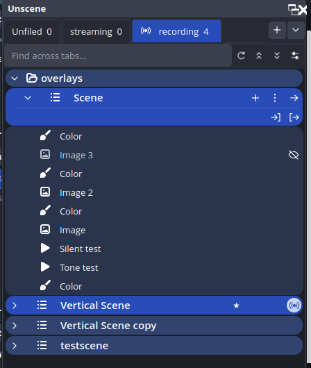
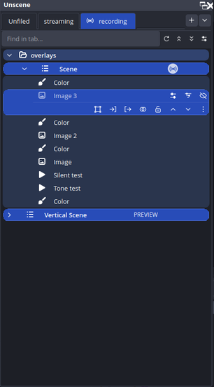
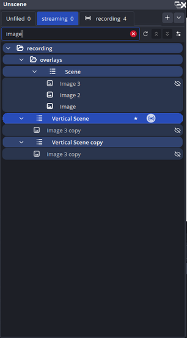

# Unscene

**Scenes and sources, unfolded.**

A native OBS Studio dock that brings your entire scene collection into one
expandable, theme-aware workspace. Organize and edit sources without constantly
switching scenes. No Aftermarket dependency.

> **0.1.0 public-preview candidate.** Developed and runtime-tested on Linux x86_64
> with OBS Studio 32.2.0 and Qt 6. CI builds OBS 32/33 packages on Linux,
> Windows and macOS; runtime qualification outside Linux OBS 32.2.0 is pending.

| Current organization and shortcuts (dark) | Earlier light-theme preview |
| :---: | :---: |
|  |  |

## Features

- **Scenes and sources in one dock:** reorderable organization-only scene tabs with nested folders, drag-to-move, and separate organization undo/redo; expand independently of activation; search
  collapsed scenes and groups; persistent expansion and thumbnail density.
- **Scene organization:** presentation-only tabs/folders, drag ordering, pinned scenes,
  all-tab search, scene counts and native scene creation/duplication.
- **Quick editing:** second-row in/out transition, transform and blending controls.
- **Dynamic appearance:** Material-inspired tonal scene containers, custom colors,
  artwork and icons, dimmed hidden sources, and theme-aware live/hover controls.
- **Source management:** add existing or new inputs, copy references or duplicates
  across scenes, rename, reorder with animated drag and edge scrolling, and
  access properties, filters and native context menus.
- **Inspector:** editable transform drafts with presets, shared filter-stack
  management and direct source usage counts; pin the current item or follow selection.
- **Portable transfers:** copy/import/export individual sources and filters or
  filter stacks as JSON. Existing sources are not overwritten.
- **Motion and safety:** Off/Fast/Smooth motion settings, native OBS undo for
  supported edits, and no snapshot capture by default.

| Source shortcuts | Search across tabs |
| :---: | :---: |
|  |  |

[Transform inspector preview](docs/screenshots/preview-inspector.png) · [Compact light-theme inspector](docs/screenshots/inspector-light-compact.png) · [Filter toolbar](docs/screenshots/inspector-light-filters.png)

[Detailed usage and limitations](docs/usage.md) · [Build checks](https://github.com/myrqyry/unscene/actions)

## Build and install

Requires a C++17 compiler, CMake 3.21+, Qt 6 Widgets/Svg development
packages, and libobs plus obs-frontend-api development packages matching the
target OBS version. The locally runtime-tested target is OBS 32.2.0 on Linux.
Linux tests require Xvfb and xauth for isolated libobs startup.

```sh
cmake -S . -B build -DCMAKE_BUILD_TYPE=Release
cmake --build build --parallel 2
ctest --test-dir build --output-on-failure
cmake --install build --prefix "$HOME/.config/obs-studio/plugins/unscene"
```

If CMake cannot locate the OBS SDK, pass
`-Dlibobs_DIR=/path/to/sdk/lib/cmake/libobs` and
`-Dobs-frontend-api_DIR=/path/to/sdk/lib/cmake/obs-frontend-api`.
Restart OBS and enable **Docks → Unscene**. You can leave the original docks open
or hide them yourself. To uninstall, close OBS and remove only the installed
Unscene plugin directory; appearance/navigation settings are separate.

The [CI workflow](.github/workflows/ci.yml) targets Linux x86-64,
Windows x64, and macOS Intel/Apple Silicon against pinned OBS 32.2.0 and
33.0.3 SDKs. Each job requires at least 20 native tests before packaging.
The earlier eight-leg matrix passed; the latest feature revision needs hosted requalification. See [CI details](docs/ci.md).

CI artifacts are preview/test packages, not automatically published releases.
OBS 32 Linux retains the original archive layout: extract into the Unscene
plugin directory above. OBS 32 Windows has an enclosing unscene folder with
bin/64bit/unscene.dll. OBS 33 Linux/Windows use a plugin directory with the
module at its root. macOS artifacts contain an unscene.plugin bundle; ad-hoc
signing is not notarization. Match the artifact to the actual OBS version and
architecture; successful compilation does not establish native runtime support.

## Important limitations

- Some direct management actions (add, reference/duplicate paste, remove,
  rename, scene creation and duplication) do not have native undo. Native menus may fall back to Unscene's own
  menus if OBS's internal model cannot be matched safely.
- Portable JSON does not package external files or remap third-party source
  references. Import only trusted settings. Scene/group bundles and item
  show/hide transitions are not supported.
- Optional idle snapshot capture uses synchronous graphics readback; disabled
  by default and gated while outputs are active. No streaming benchmark yet.
- Cross-parent source drag, full scene/group management and indirect nested scene
  usage traversal are not implemented. Scene removal remains native-only. Scene-out
  overrides apply only to Unscene activation in normal mode when the destination has
  no incoming override. This is not yet a complete native-dock replacement.

## License

GPL-3.0-or-later. See [LICENSE](LICENSE) and [attribution](NOTICE.md).

### Aftermarket interoperability
Private scene, source, placement and filter notes share Aftermarket’s UUID-keyed local note store. Unscene follows Aftermarket alternating-row colors by default, with independent scene/source overrides in Dock settings. Neither plugin is required to run the other.

Scene headers expand/collapse their source cards from any non-button area. Contiguous source bands retain the scene’s tonal color, notes and alternating-row preferences.

Expanded scene headers provide native Filters and Projector shortcuts. Visual source projectors offer aspect-aware compact monitoring and large review windows, along with native windowed/fullscreen options.
